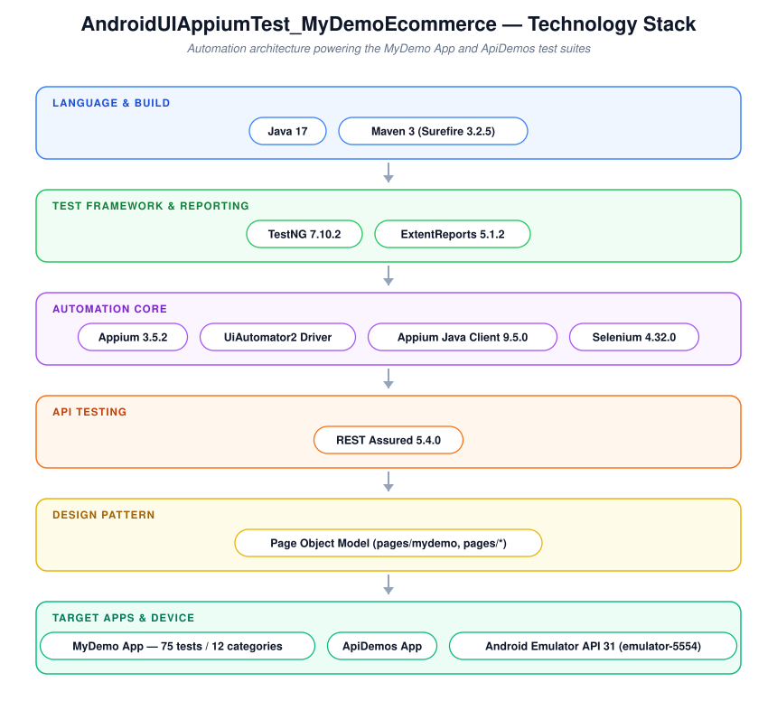
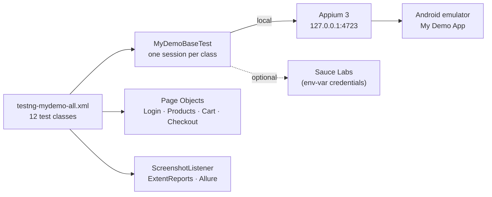
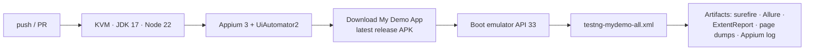

<div align="center">

# 🛍️ Android E-Commerce Automation — Sauce Labs My Demo App

### 75 Appium tests across 12 categories, running on a real Android emulator in GitHub Actions

[](https://git.io/typing-svg)

<!-- ============ STATUS BAR ============ -->
[](https://github.com/rbchy/AndroidUIAppiumTest_MyDemoEcommerce/actions/workflows/tests.yml)




</div>

---

## 📌 At a Glance

<table>
<tr>
<td width="50%" valign="top">

**🙋 What this is**

A native-Android UI automation framework for **[Sauce Labs' My Demo App](https://github.com/saucelabs/my-demo-app-android)** — a realistic e-commerce app with a catalog, product details, cart, login and a multi-step checkout. **75 tests in 12 categories** cover the shopping journey end to end, plus lifecycle, device behaviour, interrupts, performance, security and accessibility.

Every push downloads the official app release, boots an **Android emulator in GitHub Actions**, starts Appium 3 and runs the full suite.

> *Quality is never an accident; it is always the result of intelligent effort.*

</td>
<td width="50%" valign="top">

**📍 Quick facts**

| | |
|---|---|
| 📦 **App** | My Demo App 2.3.0 (`com.saucelabs.mydemoapp.android`) |
| 🤖 **Device** | Android emulator API 33 (`emulator-5554`) |
| 🧪 **MyDemo suite** | 75 tests · 12 categories |
| ✅ **CI** | 75 / 75 · 0 skipped · ≈ 10 min |
| 👤 **Demo login** | `bob@example.com` / `10203040` (public) |
| 📊 **Reports** | ExtentReports · Allure · screenshots |

</td>
</tr>
</table>

---

## ✅ Latest Results (GitHub Actions)

| Suite | File | Tests | ✅ | ❌ | ⏭️ | Time |
|---|---|---:|---:|---:|---:|---|
| **MyDemoApp — all categories** | `testng-mydemo-all.xml` | 75 | 75 | 0 | 0 | 10 m 15 s |

<sub>Ubuntu runner, Android API 33 emulator (pixel_6), Appium 3 + UiAutomator2, Temurin 17, My Demo App 2.3.0 downloaded from Sauce Labs' latest release. Reports, Allure results and Appium logs are uploaded as a build artifact on every run.</sub>

| # | Class | Tag | Tests | What it covers |
|---|---|---|---:|---|
| 1 | `MyDemoSmokeTests` | `[SMOKE]` | 6 | App launches, login screen, catalog visible |
| 2 | `MyDemoE2ETests` | `[E2E]` | 9 | Login → add to cart → checkout → order complete |
| 3 | `MyDemoAppLifecycleTests` | `[LIFECYCLE]` | 6 | Background / foreground, kill & relaunch |
| 4 | `MyDemoNavigationTests` | `[NAV]` | 7 | Menu, product detail, cart, checkout steps |
| 5 | `MyDemoDeviceBehaviorTests` | `[DEVICE]` | 5 | Back and home buttons, orientation stability |
| 6 | `MyDemoNegativeTests` | `[NEGATIVE]` | 8 | Invalid credentials, empty fields, boundary inputs |
| 7 | `MyDemoPerformanceTests` | `[PERF]` | 5 | Load-time SLAs (login ≤ 5 s, cart ≤ 3 s) |
| 8 | `MyDemoSecurityTests` | `[SECURITY]` | 5 | SQL injection and XSS input, session handling |
| 9 | `MyDemoAccessibilityTests` | `[A11Y]` | 6 | Content descriptions, focusability, labels |
| 10 | `MyDemoDataDrivenTests` | `[DATA]` | 9 | `@DataProvider` credential sets |
| 11 | `MyDemoInstallTests` | `[INSTALL]` | 4 | Fresh install, upgrade, uninstall |
| 12 | `MyDemoInterruptTests` | `[INTERRUPT]` | 5 | Incoming call, SMS, Wi-Fi toggle mid-session |
| | **Total** | | **75** | |

---

## 🏗️ How It Fits Together



**Design decisions that made the suite stable**

- **One Appium session per test class** (`@BeforeClass` / `@AfterClass`) — far faster than a session per method
- **Fast reset via ADB** — `pm clear com.saucelabs.mydemoapp.android` instead of a slow full reinstall
- **Session health check** in `@BeforeMethod` — a dead session becomes a clean skip, not a cascade of failures
- **Never press BACK from the navigation drawer** — on this app it exits to the home screen; the drawer is closed with the hamburger icon
- **Logout rescue** — after logout the app goes to the home screen, so `LoginPage` calls `activateApp()` first
- **No `currentActivity()`** — it shells out to `adb dumpsys` and can hang 20 s; health checks use `findElements()`
- **Page dumps** — `CheckoutPage` and `ProductsPage` save the page source to `page-dumps/` when a screen is unexpected

<details>
<summary><strong>📈 Stabilisation history (local runs)</strong></summary>

<br>

| Run | Pass | Fail | Skip | Change |
|---|---:|---:|---:|---|
| 5 | 61 | 10 | 4 | Baseline |
| 6 | 69 | 3 | 3 | Navigation-drawer BACK bug fixed |
| 7 | 71 | 1 | 3 | Logout → home-screen rescue |
| 11 | 75 | 0 | 1 | `terminateApp()` + `activateApp()` reset fixed two catalog-state races |
| 13 | 75 | 0 | 0 | Rotation skip replaced with a stability assertion |
| **CI** | **75** | **0** | **0** | **First run on GitHub Actions** |

</details>

---

## 🔄 CI/CD — GitHub Actions



[`.github/workflows/tests.yml`](.github/workflows/tests.yml) also has a manual **Run workflow** button with a `suite` input, e.g. `testng-mydemo-local.xml` (the 9 E2E tests) or `testng.xml` (ApiDemos).

---

## 🚀 Getting Started (local)

1. **Java 17**, **Maven 3**, **Node.js 20.19+**
2. **Appium 3** with UiAutomator2:
   ```bash
   npm install -g appium@3
   appium driver install uiautomator2
   ```
3. **Android emulator** running as `emulator-5554` (Android Studio → Device Manager)
4. **APK** (optional — without it the already-installed app is launched): download `mda-*.apk` from [My Demo App releases](https://github.com/saucelabs/my-demo-app-android/releases) to `apks/MyDemoApp.apk`

```bash
appium                                               # terminal 1
adb devices                                          # emulator-5554 should be listed

mvn clean test                                       # MyDemo E2E suite (testng-mydemo-local.xml, default)
mvn clean test -DsuiteXmlFile=testng-mydemo-all.xml  # all 75 tests
./run-mydemo-all.sh                                  # same, with a log in test-output/
mvn allure:serve                                     # Allure report
```

| Report | Location |
|---|---|
| ExtentReports HTML | `test-output/ExtentReport.html` |
| Allure | `target/allure-results/` → `mvn allure:serve` |
| Failure screenshots | `test-output/screenshots/<test>.png` |
| Page dumps | `page-dumps/<label>-dump.xml` |

<details>
<summary><strong>☁️ Sauce Labs (optional)</strong></summary>

<br>

`MyDemoBaseTest` and `BaseTest` can run on Sauce Labs real or virtual devices with `runMode=saucelabs`. Credentials are read from the environment — never commit them:

```bash
export SAUCE_USERNAME=your-username
export SAUCE_ACCESS_KEY=your-key
```

</details>

<details>
<summary><strong>📱 ApiDemos suite (secondary)</strong></summary>

<br>

The repository also contains the ApiDemos tests (`apks/ApiDemos-debug.apk`, `testng.xml`). The same suite is maintained and run in CI in **[AppiumTest_Andriod_Automation](https://github.com/rbchy/AppiumTest_Andriod_Automation)** (55 passed · 3 graceful skips · Cucumber 4 / 4). The Allure and Extent PDFs in this repository are from ApiDemos runs.

```bash
mvn clean test -DsuiteXmlFile=testng.xml
```

</details>

---

## 📁 Project Structure

```
AndroidUIAppiumTest_MyDemoEcommerce/
├── .github/
│   ├── workflows/tests.yml          ← APK download + emulator + Appium + suite
│   └── scripts/run-appium-tests.sh
├── apks/                            ← ApiDemos APK; MyDemoApp.apk downloaded (git-ignored)
├── docs/tech-stack-diagram.svg
├── page-dumps/                      ← page sources saved on unexpected screens
├── src/test/java/
│   ├── base/                        ← MyDemoBaseTest (MyDemo), BaseTest (ApiDemos)
│   ├── pages/mydemo/                ← LoginPage, ProductsPage, CartPage, CheckoutPage
│   ├── pages/                       ← ApiDemos pages
│   ├── tests/                       ← 12 MyDemo* classes + ApiDemos classes
│   ├── listeners/ScreenshotListener.java
│   └── utils/                       ← ExtentReportManager, WaitUtils
├── testng-mydemo-all.xml            ← all 12 MyDemo categories (75 tests)
├── testng-mydemo-local.xml          ← MyDemo E2E (9 tests) — Maven default
├── testng.xml                       ← ApiDemos
├── run-mydemo-all.sh · run-mydemo-local.sh
└── pom.xml
```

---

## 🧹 Maintenance Log

| Change | Why |
|---|---|
| Added `pom.xml` | The README and run scripts used it, but it was not in the repository — nothing could build |
| Added `testng-mydemo-all.xml`, `testng-mydemo-local.xml`, `testng.xml` | Referenced everywhere but missing; restored from the companion repository and Windows paths removed |
| GitHub Actions on an Android emulator, APK from Sauce Labs' release | First committed, reproducible proof of 75 / 75 |
| `apks/MyDemoApp.apk` git-ignored | Downloaded per run instead of stored |
| README: no `.bat` files or git-ignored Sauce suite files listed | They are not in the repository |

**Known limitations:** the app locks its own orientation, so the rotation test asserts stability instead of landscape layout; interrupt simulations (`adb emu`) work only on emulators; the "Continue Shopping" button is tapped best-effort with a fallback.

---

## 🔗 Related Projects

| Project | Stack |
|---|---|
| 📱 [Appium Android Automation — ApiDemos](https://github.com/rbchy/AppiumTest_Andriod_Automation) | Appium 3 · TestNG · Cucumber — CI green on an emulator |
| ⭐ [RbcTcsWorld E-Commerce Suite](https://github.com/rbchy/RbcTcsWorld_ECommerceSuite) | Spring Boot · Playwright · Appium 3 on Android and iOS · CI quality gates |
| ☁️ [Sauce Labs Cloud Automation](https://github.com/rbchy/QaBrainsSauceLabAPI_Automation) | Selenium · Cucumber · Sauce Labs browser matrix |
| 🛍️ [Sauce Demo Shop Automation](https://github.com/rbchy/Sauce-Demo.MyShopify.AutomationTest) | Selenium · Cucumber — CI green |

<sub>All projects: [github.com/rbchy](https://github.com/rbchy)</sub>

---

## 👤 Author

<div align="center">

**Ranajit Baran Chowdhury (RB Chowdhury)**
QA Automation Engineer / SDET · West Norriton, Pennsylvania, USA

[](https://www.linkedin.com/in/rbchy/)
[](https://github.com/rbchy)
[](https://rbchy.github.io/rbchy/)
[](https://rbc6543.wixsite.com/rbc-portfolio)
[](mailto:chyranajit@gmail.com)

<sub>A personal learning and portfolio project. The My Demo App is owned by <a href="https://saucelabs.com/">Sauce Labs, Inc.</a></sub>

⭐ *If this framework helps you, a star on the repo is appreciated.*

</div>
